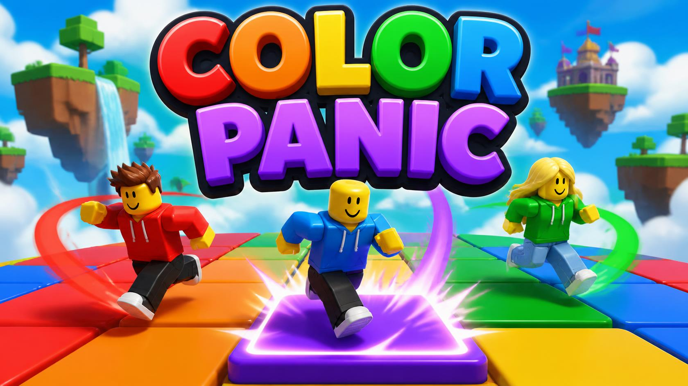

# Color Panic

**Find the color. Survive the chaos. Be the last one standing.**

A round-based party game for 2 to 12 players, built for Roblox. A target flashes up on screen,
*Red Heart*, *Blue Circle*, *Purple Square*, and you have a few seconds to reach a tile that
matches it. Every other tile drops away into the clouds. Miss it and you are out.

Each round is faster than the last. From round 3 the target hides after a quick look, so you
have to remember it. From round 4 the tiles start shrinking. The last player standing wins.



**Play it:** [Color Panic [BETA] on Roblox](https://www.roblox.com/games/95448694004978)

---

## Contents

- [What is in the build](#what-is-in-the-build)
- [How a match plays](#how-a-match-plays)
- [Design decisions worth calling out](#design-decisions-worth-calling-out)
- [Tools and technology](#tools-and-technology)
- [How the code is organised](#how-the-code-is-organised)
- [Quality: tests, types, lint](#quality-tests-types-lint)
- [Running it yourself](#running-it-yourself)
- [Configuration](#configuration)
- [3D models and art pipeline](#3d-models-and-art-pipeline)
- [What is not built yet](#what-is-not-built-yet)
- [Credits and licence](#credits-and-licence)

---

## What is in the build

| | |
| --- | --- |
| **Title screen and menu** | Logo, Play, a how-to-play card showing all six colour and shape pairs, and a settings panel |
| **Join queue** | Players start in the menu. Only players who press Play count toward a match, and Leave takes them back out before it starts |
| **Lobby** | A floating island with spawn pads, a readiness panel and a countdown banner |
| **Rounds** | Round banner, a timer with a 3 second warning, shaped tiles, reveal-then-hide targets from round 3, shrinking tiles from round 4, a round cap with "Final round!" |
| **Elimination** | An "Eliminated!" card, then free spectating: the camera follows a survivor, and you can switch or stop at any time |
| **Results** | Winner, places and rounds survived |
| **Persistence** | Wins, coins and daily rewards saved per player, with session locking so two servers can never save over each other |
| **Presentation** | Three hand-assembled 3D islands floating over a cloud sea, a custom skybox, glossy tiles, confetti, dust puffs, 9 sound effects and 2 music loops |

## How a match plays

1. Press **Play** on the title screen. A match starts once at least 2 players are queued.
2. Each round announces a target, for example **Red Heart**. Run to a tile with that colour
   *and* that shape before the timer runs out.
3. Every other tile drops. Anyone not standing on a target tile is eliminated and can spectate.
4. Rounds speed up, the target starts hiding, the tiles start shrinking. Last player standing
   wins; anyone still alive after the final round shares it.

## Design decisions worth calling out

**Every colour carries its own shape.** Red is a heart, blue is a circle, purple is a square,
and so on. The game can be played start to finish without being able to tell the colours apart,
which makes it work for colour blind players. A test fails the build if a colour or shape name
is hardcoded anywhere outside the config module, so the pairing cannot quietly drift.

**The server decides everything.** Clients draw what they are told and send exactly two
requests, Play and Leave, both validated server side. Match state, round generation, tile
removal, who is out, placement and results are all decided on the server. Nothing a client
sends can change the outcome of a round.

**Fairness is enforced, not hoped for.** The round generator guarantees at least one matching
tile per two surviving players, so a round can never be unwinnable by arithmetic.

**Game rules are pure functions.** The logic that decides match state, round difficulty and
elimination touches no Roblox instances at all, which is why it can be tested outside Studio
(see below). The same split applies on the client: every controller draws from a pure view
model, and the view models are what the tests cover.

**No magic numbers.** Every tunable value (timers, grid size, colours, fonts, volumes, camera
angles) lives in one config module. Services read it; they never hardcode.

**Built for phones.** Triangle and part budgets are enforced per mesh and per model by a test
that reads a manifest, because Roblox cannot report triangle counts from a model file.

## Tools and technology

| Tool | Version | What it does here |
| --- | --- | --- |
| **Luau** | | The language. `--!strict` on core modules |
| **[Rojo](https://rojo.space/)** | 7.7.1 | Syncs the filesystem into Roblox Studio, so the project lives in Git rather than inside a `.rbxl` |
| **[Rokit](https://github.com/rojo-rbx/rokit)** | | Toolchain manager. Pins every tool version in `rokit.toml`, so the build is reproducible |
| **[Lune](https://github.com/lune-org/lune)** | 0.10.5 | Runs the test suite outside Roblox Studio, in seconds |
| **[luau-lsp](https://github.com/JohnnyMorganz/luau-lsp)** | 1.70.1 | Strict type checking against real Roblox API types, outside Studio |
| **[StyLua](https://github.com/JohnnyMorganz/StyLua)** | 2.5.2 | Formatter |
| **[Selene](https://github.com/Kampfkarren/selene)** | 0.32.0 | Linter, with the Roblox standard library |
| **[Wally](https://wally.run/)** | 0.3.2 | Package manager. One dependency: ProfileStore, for player data session locking |
| **Blender** | 5.2 | Scripted mesh prep: decimation to budget, UV re-bake, recolour, FBX export |

Everything is version pinned, so `rokit install` gives a new contributor the exact same
toolchain.

## How the code is organised

```
src/
  server/          Game rules and services, server authoritative
  client/          Controllers that draw, plus their pure view models
  shared/          Config, Types, Remotes, pure rule modules
  replicatedfirst/ The loading screen, which must run before anything else
models/            Four .rbxm 3D models, mapped straight into Workspace
tests/             33 spec files, run outside Studio with Lune
qa/                QA records per slice, and Studio command bar snippets
art/               Palette, UI source art, model manifests
docs/              Design and task documents
scripts/           Type check and test runners
tools/blender/     The mesh and skybox preparation pipeline
```

| Folder | Becomes in Roblox |
| --- | --- |
| `src/server` | `ServerScriptService.Server` |
| `src/shared` | `ReplicatedStorage.Shared` |
| `src/client` | `StarterPlayer.StarterPlayerScripts.Client` |
| `src/replicatedfirst` | `ReplicatedFirst` |
| `models` | `Workspace`, one top-level model per file |

Entry points are `Main.server.luau` and `Main.client.luau`.

**The main pieces.** `MatchService` runs the match state machine (with the pure `MatchFlow`),
`RoundDirector` generates rounds and enforces the fairness rule, `ArenaService` builds and
strips the tile grid, `EliminationService` and `EliminationRules` decide who is out,
`PlacementService` moves players between lobby, arena and spectator island, and `DataService`
saves player data behind the pure `SessionRules`. On the client, `HUDController`,
`MenuController`, `SpectateController`, `AudioController` and `LookController` each render from
a matching pure model. Remotes are declared only in `shared/Remotes`.

## Quality: tests, types, lint

```bash
bash scripts/test.sh        # 469 assertions across 33 spec files, no Studio needed
bash scripts/typecheck.sh   # strict Luau types against real Roblox API definitions
stylua --check src tests    # formatting
selene src tests            # linting
```

All four run before any pull request is opened. The test harness reads the Rojo sourcemap, so
modules keep their normal Roblox-style requires (`script.Parent.X`, `game:GetService(...)`) and
nothing has to be written specially in order to be testable.

What the tests cover: the match state machine, round generation and the fairness rule,
elimination, results and placement, the join queue, every UI view model, the config contract (a
colour or shape name outside Config fails the build), and the 3D model builder rules, which
check anchoring, palette compliance, clearance around the arena and phone budgets against every
`.rbxm` file in the repository.

QA that cannot be automated is recorded by hand, one file per slice, in `qa/`.

## Running it yourself

1. Install [Rokit](https://github.com/rojo-rbx/rokit), then from the repository root:

   ```bash
   rokit install
   ```

   Rokit asks you to trust each tool the first time. Versions come from `rokit.toml`.

2. Install the one package the game depends on:

   ```bash
   wally install
   ```

   This creates `ServerPackages/`, which is not in Git; `wally.lock` pins the exact version.
   Without this step the game still runs, but player data is held in memory and never saved,
   and the server log says so.

3. Install the Rojo plugin in Roblox Studio, matching the Rojo version above.

**Build a place file:**

```bash
rojo build default.project.json -o ColorPanic.rbxl
```

**Live sync into Studio:**

```bash
rojo serve
```

Then open a place in Studio and click Connect in the Rojo plugin (default port 34872).

### Testing in Studio

- Use **Test, Server and Clients with 2 clients.** Do not run 8 local clients; one machine runs
  out of memory.
- Players start in the menu, so press **Play** in each client window.
  `qa/snippets/press_play.client.luau` does the same from a client command bar.
- A match needs 2 queued players. For a one-player match in Studio only, set
  `Config.Match.studioSinglePlayerEnabled = true`. It never applies to live servers.
- Test actors must walk (`qa/snippets/actor.client.luau`). Client-side teleports do not always
  reach the server.

### Publishing

Build from `main` and publish under the **same account that owns the uploaded images and
sounds** (the asset IDs in `Config.Assets`). Roblox audio is private to its owner, so under
another account or a group the sounds stay silent until that experience is granted access.

## Configuration

Every tunable value lives in `src/shared/Config.luau`.

| Table | What it controls |
| --- | --- |
| `Colors` | The six colours, their hex values and shapes, mirrored from `art/palette.json` (a test keeps them in step) |
| `Difficulty`, `Match`, `StateSeconds` | Round timers, colour counts, reveal times, the round cap, state lengths |
| `Shrink` | Shrinking tiles: from which round, how much per round, the smallest size |
| `Assets`, `Art` | Roblox asset IDs for images and sounds. Use Image IDs, not Decal IDs. An ID of 0 skips the asset and shows a text fallback |
| `Hud`, `Banner`, `Lobby`, `Spectate`, `Results`, `Menu` | UI sizes, positions, colours and fonts |
| `Look`, `Audio` | Lighting, bloom, tile gloss, props, confetti, sound and music volumes |

**Presets.** `ACTIVE_PRESET` at the top of `Config.luau` applies a named preset on top of the
normal values. `"demo"` shortens the intermission, caps a match at 8 rounds and turns on
shrinking tiles; `"normal"` changes nothing. A preset lists only what differs, and an unknown
key or a wrong type is an error at startup rather than a silent miss.

## 3D models and art pipeline

Models live in `models/` as `.rbxm` files. Rojo maps each one into `Workspace` under its file
name, so `models/Lobby.rbxm` becomes `workspace.Lobby`. `Workspace` uses
`$ignoreUnknownInstances`, so the baseplate and everything built at runtime are left alone.

| File | What it is |
| --- | --- |
| `models/Lobby.rbxm` | The floating lobby island: 12 spawn pads around a crowned platform, an entrance arch, palms, lamps, pillars, rocks |
| `models/SpectatorArea.rbxm` | A smaller island beside the arena, with 12 spawn pads |
| `models/ArenaIsland.rbxm` | The island under the tile grid, 12 studs below the tiles, so players who fall land on it (they are still judged out) |
| `models/CloudSea.rbxm` | A white cloud floor and 10 cloud meshes |

The sky is code, not a model: `LookController` builds it from `Config.Assets.Images.sky`.

`tests/Models.spec.luau` checks every model file against the builder rules in
`tests/ModelRules.luau`: every part anchored, only palette colours or neutrals, nothing visible
or collidable intruding on the arena square, a valid `Spawns` folder on the two island models,
and the phone budgets (400 parts per model, 20,000 triangles per mesh, 80,000 per model).

**Rebuilding a model.** Source art stays outside Git. `tools/blender/prep_models.py` takes each
source mesh export, decimates it to its triangle budget, bakes its texture onto new UVs,
recolours to the palette and exports an FBX in studs, with per-model targets read from
`art/lobby_models.json`. The FBX is imported with Studio's 3D Importer, assembled with the
command bar scripts in `tools/studio/`, saved back into `models/`, and its triangle counts added
to `art/models_manifest.json`. Then `bash scripts/test.sh` checks the new file.

## What is not built yet

Stated plainly, because `SPEC.md` shows the full plan and these are the parts it does not yet
reach:

- **Shove** (pushing other players) and **spectator pranks**: designed in `SPEC.md`, not started.
- **Monetisation and shop:** not built. No shop appears anywhere in the game.
- **A playtest with 4 or more real players** has not been run. The checklist is ready and empty
  at `qa/demo-qa.md`. Difficulty tuning past round 8 is waiting on it.
- **A test on a real low-end phone.** Triangle and part budgets pass, but measured frame rate
  and join time on a phone are unknown. This is the largest open risk in the project.

## Credits and licence

- Code and game design: 7Kbytes.
- Palette and shape pairings: `art/palette.json`.
- 3D source meshes were generated with Meshy AI and then prepared for Roblox through the
  Blender pipeline in `tools/blender/` (decimation, UV re-bake, palette recolour). UI art was
  likewise generated, then trimmed, converted and uploaded; `art/ui/README.md` records each
  picture's source and its uploaded size.
- Licensed under Apache-2.0 (see `wally.toml`).

Requirements, architecture and the full slice plan are in [`SPEC.md`](SPEC.md).
